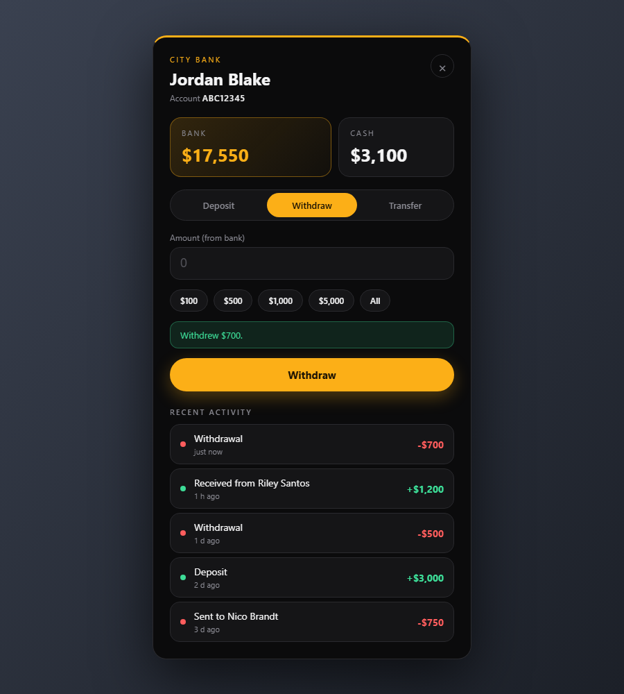

# bank-nui

An ATM and banking window for FiveM (Qbox and ESX), built with React + TypeScript. **Every money operation is decided by the server**, the window only asks.



## Features

- ATM window on every ATM prop (through `ox_target`): bank and cash balance, deposit, withdraw, transfer to any account and recent activity.
- Transfers by account number. On Qbox the number is the character id and offline players can receive money. On ESX every character gets a short generated number, and only players who are online can receive transfers.
- Transaction history in the database, with the balance after each operation.
- Clean black and yellow UI with quick amount buttons.

## Security model

| Check | Where |
| --- | --- |
| Amount must be a whole number inside the limits (text, NaN, infinity and negatives are rejected) | server |
| Bank balance is checked before every withdrawal and transfer (the framework itself lets a bank balance go below zero) | server |
| The player must have opened an ATM and stay within a few meters of it, sessions expire | server |
| Cooldown between actions of one player | server |
| A failed second step of a transfer or deposit gives the money back | server |
| You cannot send money to yourself, unknown accounts are refused | server |
| SQL uses parameterized queries | server |

Note: ATM props exist only on the client, so the server cannot check that a real ATM is there. It checks the session and the distance from where the window was opened. A tool that fakes the open request could open the window anywhere, but it still could not exceed balances, limits, rate or distance rules. For stricter setups, replace the ATM props with fixed bank locations that the server knows.

## Requirements

- [ox_lib](https://github.com/overextended/ox_lib), [ox_target](https://github.com/overextended/ox_target), [oxmysql](https://github.com/overextended/oxmysql)
- One framework, detected automatically: Qbox ([qbx_core](https://github.com/Qbox-project/qbx_core)) or ESX (es_extended)
- Node.js (only to build the UI)

## Framework support

| Framework | Status |
| --- | --- |
| Qbox | Tested in game (FiveM build 3258) |
| ESX | Implemented, **not tested yet**. Transfers go to online players only |
| QBCore | Not implemented |

All framework code is in `bridge/server.lua`, so other frameworks can be added there without touching the rest.

## Installation

1. Copy this folder into your `resources` directory.
2. Build the UI:
   ```
   cd web
   npm install
   npm run build
   ```
3. If another banking resource also adds ATM targets (for example Renewed-Banking), stop it, otherwise players see two options.
4. Add `ensure bank-nui` to your `server.cfg`. The table `bank_nui_transactions` is created automatically.

## Configuration

See [config.lua](config.lua): bank name, ATM models, limits per operation, maximum distance, session length, cooldown and history length.

## UI development

```
cd web
npm run dev
```

In a normal browser the window runs against a small fake bank, so the design can be worked on without the game.

## License

All rights reserved. See [LICENSE](LICENSE).
